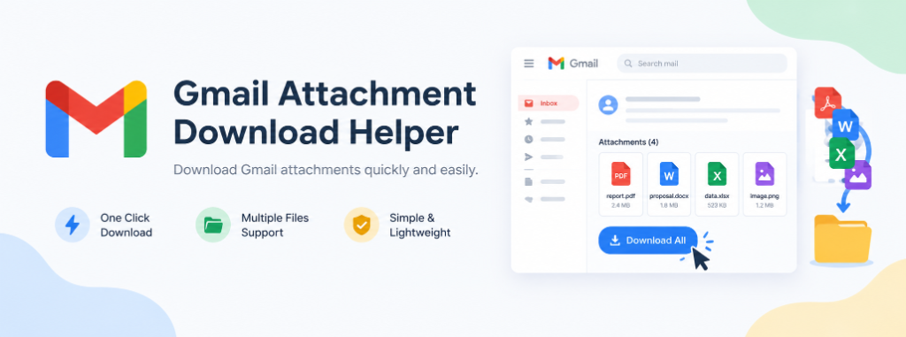
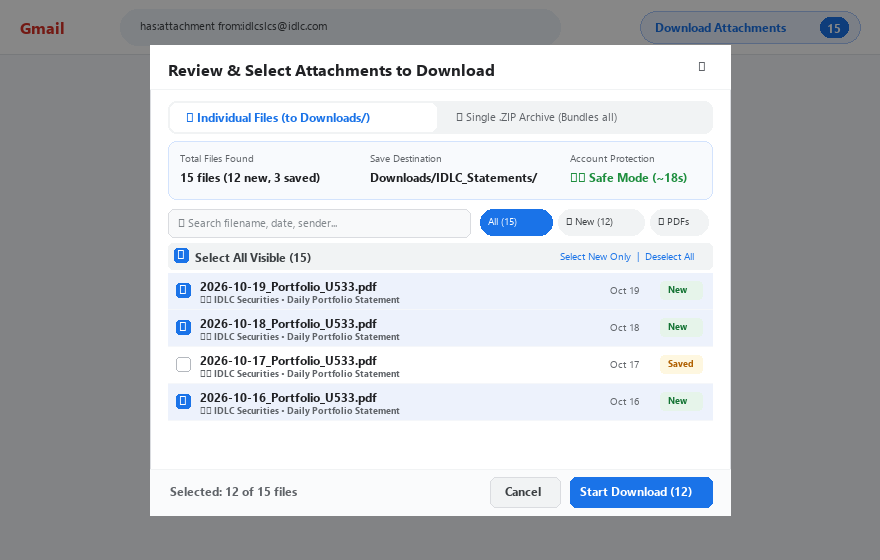

<p align="center">
  
</p>

<p align="center">
  <a href="https://github.com/siddik-web/gmail-attachment-download-helper/releases/latest"></a>
  
  
  <a href="LICENSE"></a>
</p>

---

## 📌 Overview

**Universal Gmail Bulk Attachment Downloader** is a modern Chrome Extension (Manifest V3) that discovers, selects, and bulk downloads **ANY** email attachment (PDF, Excel, Word, ZIP, Images, CSV, etc.) directly from Gmail search results or thread listings.

Equipped with a **Single .ZIP Archive bundler**, **multi-page auto-advance crawler**, **CSV audit manifest export**, **smart duplicate prevention**, and an **intelligent anti-ban rate-limit shield**.

<p align="center">
  
</p>

---

## ⚡ Key Highlights & Features

### 📦 1. Single .ZIP Archive Bundling
- Choose between saving **Individual Files** to a subfolder or bundling all selected attachments into a **Single `.zip` file** (e.g. `Attachments_2026-10-20.zip`).
- **Zero download clutter**: Chrome only receives one single file, eliminating repetitive download prompts.
- Automatically generates and bundles a `manifest.csv` audit sheet inside the `.zip` archive.

### ⏭️ 2. Multi-Page Crawling / Auto-Advance
- When your search query yields hundreds of emails spanning multiple pages (`1–50 of 240`), enable **Auto-advance through next pages**.
- Once Page 1 finishes downloading, the extension automatically clicks Gmail's `>` next-page button, waits for rendering, and continues downloading seamlessly.

### 📊 3. CSV Audit Manifest Export
- Every download session generates a structured audit log containing:
  - `Email Date`, `Sender`, `Subject`, `Saved Filename`, `Original Filename`, `Status`, `Timestamp`
- Export with a single click from the completion toast or the Settings panel.

### ✉️ 4. Sender & Subject In-Modal Filtering
- Directly inside the interactive review modal, inspect the **Sender** and **Subject** of each email.
- Real-time search allows instantaneous filtering by email address (e.g. `billing@company.com`) or subject keywords.

### 🔔 5. Desktop Notifications & Chimes
- Audio feedback upon completion accompanied by native Chrome desktop notifications, allowing you to run bulk downloads in background tabs worry-free.

---

## 🔒 Account Safety & Rate-Limit Shield

To guarantee **100% account safety and zero risk of rate-limiting, temporary blocks, or CAPTCHA triggers**, the extension operates with built-in safeguards:

1. **Human-Like Randomized Pacing (Jitter)**: Staggers download requests between 1200ms – 1800ms.
2. **Anti-Burst Batch Cooldown**: Pauses for **5 seconds after every 10 downloads** to allow Gmail's token bucket to replenish.
3. **Automated Exponential Backoff**: Pauses for **15 seconds** if an HTTP 429 or rate-limit response is encountered.
4. **100% Client-Side Privacy**: Operates entirely inside your authenticated browser session without external servers, tracking, or credential storage.
5. **Duplicate Prevention**: Tracks downloaded hashes/filenames so you never waste bandwidth downloading the same file twice.

---

## 🚀 Installation Guide

### Option 1: Install from GitHub Release (Recommended)

1. Go to the [**Latest Release**](https://github.com/siddik-web/gmail-attachment-download-helper/releases/latest) page.
2. Download the `gmail-bulk-attachment-downloader-v1.2.1.zip` file under **Assets**.
3. Unzip the file into a folder of your choice on your computer.
4. Open Google Chrome and navigate to:
   ```text
   chrome://extensions/
   ```
5. Enable the **Developer mode** toggle in the top-right corner.
6. Click **Load unpacked** in the top-left corner.
7. Select the extracted folder containing `manifest.json`.

---

### Option 2: Clone from Source

```bash
git clone https://github.com/siddik-web/gmail-attachment-download-helper.git
cd gmail-attachment-download-helper
```
Then load the directory as an unpacked extension in `chrome://extensions/`.

---

## 💡 How to Use

1. **Search**: Open [Gmail](https://mail.google.com/) and search for your target emails (e.g., `has:attachment` or `from:billing@example.com`).
2. **Launch**: Click the floating **"Download Attachments"** button positioned in the top-right toolbar.
3. **Review & Configure**:
   - Choose output format: **Single .ZIP Archive** or **Individual Files**.
   - Use the filter input or date selector to pick files.
   - Select or deselect individual items.
4. **Download**: Click **Start Download**.
5. **Audit**: Once done, click **Export CSV** or **Open Folder** to access your downloaded files.

> [!TIP]
> If using **Individual Files** mode, go to `chrome://settings/downloads` and ensure **"Ask where to save each file before downloading"** is toggled **OFF** to avoid individual file prompt dialogs.

---

## 🛡️ Permissions Breakdown

| Permission | Purpose |
| :--- | :--- |
| `downloads` | Downloads attachments and saves ZIP archives to your local Downloads folder. |
| `activeTab` | Detects Gmail thread items and attachment links on the currently open Gmail tab. |
| `storage` | Remembers your preferences (safe delay settings, duplicate history, filter choices). |
| `notifications` | Displays a notification banner when a bulk download queue completes. |
| `https://mail.google.com/*` | Restricts content script execution strictly to Gmail webmail URLs. |

---

## 📂 Project Structure

```text
gmail-attachment-download-helper/
├── manifest.json         # Extension Manifest V3 configuration
├── background.js         # Service worker handling chrome.downloads & notifications
├── content.js            # Gmail DOM scanner, modal UI, and queue processor
├── styles.css            # Modern Google-styled UI modal & progress toast styles
├── lib/
│   └── jszip.min.js      # Client-side ZIP bundling engine
├── icons/                # Extension application icons (16, 48, 128)
├── assets/               # Banner, screenshots, and visual documentation
├── generate_assets.py    # Generator script for documentation assets
└── README.md             # Project documentation
```

---

## 🤝 Contributing

Contributions, bug reports, and feature requests are welcome!
Feel free to open an issue or submit a pull request on the [Issues](https://github.com/siddik-web/gmail-attachment-download-helper/issues) page.

---

## 📄 License

This project is licensed under the [MIT License](LICENSE) - Copyright (c) 2026 [Md Siddiqur Rahman](https://github.com/siddik-web).
